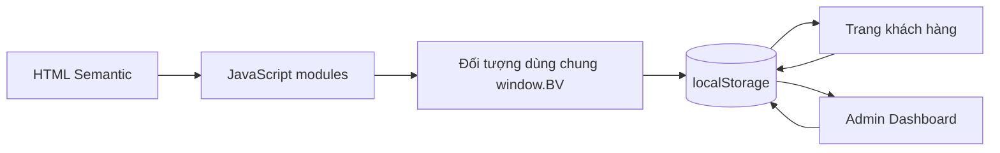
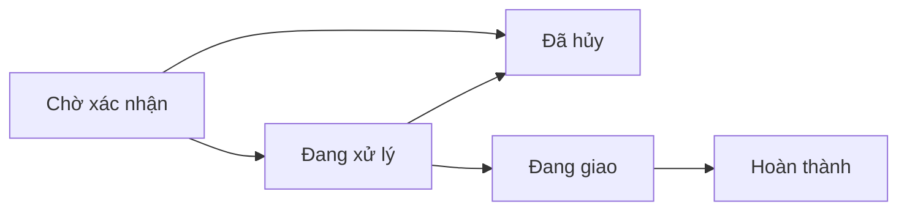

# BOOKVERSE — Website bán sách trực tuyến

> **Mở trang sách, mở thế giới.**

BOOKVERSE là đồ án môn **Thiết kế Website**, mô phỏng một hệ thống bán sách trực tuyến hoàn chỉnh bằng **HTML5, CSS3 và JavaScript ES6+ thuần**. Dự án không sử dụng framework và không có backend; toàn bộ dữ liệu demo được quản lý bằng `localStorage` để có thể chạy ngay với Live Server.

README này đồng thời là tài liệu cài đặt, kiểm thử, thuyết trình và minh chứng quá trình sử dụng Prompt Engineering để điều khiển AI giải quyết các yêu cầu có logic phức tạp.

---

## 1. Thông tin đồ án

| Nội dung | Thông tin |
|---|---|
| Tên đề tài | Website bán sách trực tuyến BOOKVERSE |
| Loại dự án | Front-end thuần, dữ liệu demo trên trình duyệt |
| Môn học | Thiết kế Website |
| Sinh viên | _Điền họ tên trước khi nộp_ |
| Mã sinh viên | _Điền mã sinh viên trước khi nộp_ |
| Lớp | _Điền lớp trước khi nộp_ |
| Giảng viên | _Điền tên giảng viên trước khi nộp_ |

### Mục tiêu

- Xây dựng giao diện nhà sách hiện đại, responsive và dễ sử dụng.
- Áp dụng Semantic HTML5, CSS Variables, Flexbox và Grid.
- Tổ chức JavaScript theo từng nhóm chức năng rõ ràng.
- Mô phỏng đầy đủ luồng mua hàng và quản trị dữ liệu.
- Đồng bộ dữ liệu giữa trang khách hàng và Admin bằng `localStorage`.
- Thể hiện khả năng phân tích yêu cầu, điều khiển AI và kiểm thử kết quả.

---

## 2. Điểm nổi bật

- Giao diện tiếng Việt, hỗ trợ sáng/tối và responsive.
- Nền gradient vũ trụ, quầng sáng, hạt sáng và sao chuyển động.
- Card sách và ảnh bìa có hiệu ứng chiều sâu 3D.
- Popup chào mừng có mã giảm giá `BOOK10`.
- Tìm kiếm, lọc, sắp xếp và tải thêm sách.
- Trang chi tiết đọc ID từ query string, ví dụ `book-detail.html?id=BV001`.
- Giỏ hàng kiểm tra tồn kho, tính phí vận chuyển và mã giảm giá.
- Đăng ký, đăng nhập, đăng xuất và phân quyền `customer`/`admin`.
- Checkout sinh mã đơn hàng và đồng bộ sang Admin.
- Quản trị sách, danh mục, đơn hàng, khách hàng và khuyến mãi.
- Báo cáo từ dữ liệu đang lưu và xuất CSV.
- Lưu email đăng ký nhận tin, hiển thị trong Admin → Khách hàng.
- Bình luận, chấm sao và lưu đánh giá riêng cho từng cuốn sách.
- Tôn trọng `prefers-reduced-motion` và hỗ trợ thao tác bàn phím cơ bản.

---

## 3. Công nghệ sử dụng

| Nhóm | Công nghệ |
|---|---|
| Cấu trúc | HTML5 Semantic |
| Giao diện | CSS3 thuần, CSS Variables, Flexbox, Grid |
| Lập trình | JavaScript ES6+ thuần |
| Lưu trữ | Web Storage API — `localStorage`, `sessionStorage` |
| Font | Google Fonts — Be Vietnam Pro |
| Icon | Font Awesome Free 6.5.2 |
| Chuyển động | Animate.css 4.1.1, AOS 2.3.1 và CSS Keyframes |
| Biểu đồ | CSS thuần, không sử dụng Chart.js |
| Môi trường chạy | Visual Studio Code + Live Server |

### Không sử dụng

- React, Vue, Angular.
- Bootstrap, Tailwind CSS.
- PHP, Node.js backend hoặc cơ sở dữ liệu server.
- Thanh toán tiền thật.

---

## 4. Kiến trúc tổng thể



Website dùng một nguồn dữ liệu chung trong `localStorage`. Trang khách hàng và Admin không có hai bộ dữ liệu riêng. Ví dụ:

1. Khách hàng đặt hàng tại `checkout.html`.
2. `checkout.js` lưu đơn vào `bv_orders`.
3. Admin đọc cùng khóa `bv_orders` để hiển thị đơn vừa tạo.
4. Khi Admin cập nhật trạng thái, Dashboard và Báo cáo đọc lại dữ liệu mới.

### Phân chia module JavaScript

| File | Trách nhiệm chính |
|---|---|
| `storage.js` | Khởi tạo dữ liệu, đọc/ghi `localStorage`, API dùng chung |
| `main.js` | Header, footer, theme, popup, toast, newsletter, hiệu ứng chung |
| `books.js` | Card sách, danh sách, tìm kiếm, lọc và điều hướng card |
| `book-detail.js` | Chi tiết sách, số lượng, sách liên quan, bình luận và đánh giá |
| `cart.js` | Giỏ hàng, tồn kho, giảm giá, vận chuyển và tổng tiền |
| `checkout.js` | Kiểm tra form, tạo mã đơn và lưu đơn hàng |
| `auth.js` | Đăng ký, đăng nhập, phiên người dùng, tài khoản và phân quyền |
| `admin.js` | Chức năng CRUD và báo cáo trong khu vực Admin |
| `admin-dashboard.js` | Điều hướng Admin và bảng email đăng ký nhận tin |

---

## 5. Cấu trúc thư mục

```text
baicuoiky/
├── index.html
├── books.html
├── book-detail.html
├── cart.html
├── checkout.html
├── login.html
├── register.html
├── account.html
├── about.html
├── contact.html
├── 404.html
├── README.md
├── assets/
│   ├── css/
│   │   ├── style.css
│   │   ├── responsive.css
│   │   ├── animations.css
│   │   ├── auth.css
│   │   └── admin.css
│   ├── js/
│   │   ├── storage.js
│   │   ├── main.js
│   │   ├── books.js
│   │   ├── book-detail.js
│   │   ├── cart.js
│   │   ├── checkout.js
│   │   ├── auth.js
│   │   └── admin.js
│   ├── images/
│   │   ├── books/
│   │   ├── banners/
│   │   ├── categories/
│   │   └── logo/
│   └── icons/
└── admin/
    ├── index.html
    ├── books.html
    ├── categories.html
    ├── orders.html
    ├── customers.html
    ├── promotions.html
    ├── reports.html
    ├── settings.html
    ├── css/admin-dashboard.css
    └── js/admin-dashboard.js
```

---

## 6. Hướng dẫn chạy dự án

### Cách 1 — Live Server

1. Mở thư mục `baicuoiky` bằng Visual Studio Code.
2. Mở tab **Extensions** bằng `Ctrl + Shift + X`.
3. Cài extension **Live Server** của Ritwick Dey.
4. Mở `index.html`.
5. Nhấn **Go Live** ở thanh trạng thái hoặc chọn **Open with Live Server**.

Địa chỉ thường có dạng:

```text
http://127.0.0.1:5500/index.html
```

### Cách 2 — Static HTTP Server

Nếu máy có Python:

```bash
py -m http.server 5500
```

Sau đó mở `http://127.0.0.1:5500`.

> Không nên mở trực tiếp bằng URL `file:///...` vì trình duyệt có thể áp dụng quy tắc unique origin và hạn chế một số thao tác lưu trữ hoặc tải tài nguyên.

Không cần `npm install`, không cần build và không cần kết nối cơ sở dữ liệu.

---

## 7. Tài khoản demo

### Khách hàng

```text
Email: customer@bookverse.demo
Mật khẩu: Book123!
```

### Quản trị viên

```text
Email: admin@bookverse.demo
Mật khẩu: Admin123!
```

Trang đăng nhập có nút điền nhanh tài khoản mẫu để giảng viên kiểm thử.

---

## 8. Danh sách trang

| Trang | Chức năng |
|---|---|
| `index.html` | Trang chủ, popup, danh mục, sách nổi bật, newsletter |
| `books.html` | Tìm kiếm, lọc, sắp xếp, tải thêm |
| `book-detail.html?id=BV001` | Chi tiết, tồn kho, mua sách, bình luận, sách liên quan |
| `cart.html` | Cập nhật số lượng, xóa, mã giảm giá, tổng tiền |
| `checkout.html` | Thông tin nhận hàng, COD/chuyển khoản, tạo đơn |
| `login.html` | Đăng nhập và tài khoản demo |
| `register.html` | Đăng ký và kiểm tra email trùng |
| `account.html` | Hồ sơ, đơn hàng, yêu thích, đổi mật khẩu |
| `about.html` | Giới thiệu thương hiệu |
| `contact.html` | Liên hệ và chính sách |
| `404.html` | Trang không tìm thấy |
| `admin/index.html` | Dashboard và thống kê |
| `admin/books.html` | CRUD sách |
| `admin/categories.html` | CRUD danh mục |
| `admin/orders.html` | Tìm kiếm, xem và chuyển trạng thái đơn |
| `admin/customers.html` | Khách hàng và email nhận tin |
| `admin/promotions.html` | CRUD mã khuyến mãi |
| `admin/reports.html` | Báo cáo và xuất CSV |
| `admin/settings.html` | Cấu hình cửa hàng và giao diện |

---

## 9. Mô hình dữ liệu localStorage

| Khóa | Nội dung |
|---|---|
| `bv_books` | Danh sách sách và tồn kho |
| `bv_categories` | Danh mục sách |
| `bv_users` | Tài khoản demo |
| `bv_session` | Phiên đăng nhập hiện tại |
| `bv_cart` | Giỏ hàng |
| `bv_wishlist` | Danh sách yêu thích |
| `bv_orders` | Đơn hàng và lịch sử trạng thái |
| `bv_promotions` | Mã khuyến mãi |
| `bv_settings` | Cấu hình cửa hàng và theme |
| `bv_newsletter_subscribers` | Email đăng ký nhận tin |
| `bv_book_comments` | Bình luận và số sao theo sách |

### Nguyên tắc khởi tạo

`storage.js` chỉ tạo dữ liệu mặc định khi khóa chưa tồn tại. Việc tải lại trang không ghi đè thay đổi của người dùng hoặc Admin.

---

## 10. Quy tắc nghiệp vụ quan trọng

### Giỏ hàng

```text
1 ≤ số lượng trong giỏ ≤ số lượng tồn kho
```

- Không cho số lượng âm hoặc bằng 0.
- Không cho thêm vượt tồn kho.
- Tổng từng dòng bằng `giá bán × số lượng`.
- Tổng thanh toán bằng `tạm tính + vận chuyển − giảm giá`.

### Khuyến mãi

- `BOOK10`: giảm 10% cho đơn từ 200.000đ.
- `FREESHIP`: giảm phí vận chuyển cho đơn từ 350.000đ.
- Mã phải còn hạn và đang kích hoạt.

### Trạng thái đơn hàng



Admin không thể chuyển trạng thái tùy ý ngoài các nhánh trên.

### Phân quyền

- Người chưa đăng nhập chỉ truy cập trang công khai.
- Khách hàng truy cập tài khoản, yêu thích và checkout.
- Nút **Vào Admin** chỉ tồn tại với tài khoản có `role: "admin"`.
- Người dùng thường nhập URL Admin sẽ bị chuyển về trang đăng nhập.

### Bình luận sách

- Tên hiển thị: 2–60 ký tự.
- Đánh giá: số nguyên từ 1–5 sao.
- Nội dung: 5–800 ký tự.
- Dữ liệu được liên kết bằng `bookId`.
- Nội dung người dùng được escape trước khi đưa vào HTML.

---

## 11. Ma trận chức năng và minh chứng

| Yêu cầu | File xử lý | Cách kiểm chứng |
|---|---|---|
| Tìm kiếm/lọc sách | `books.js` | Nhập từ khóa, đổi danh mục và khoảng giá |
| Chi tiết theo ID | `book-detail.js` | Mở `?id=BV001`, thử ID không tồn tại |
| Giới hạn tồn kho | `storage.js`, `cart.js` | Thử nhập số lượng lớn hơn tồn kho |
| Lưu giỏ hàng | `storage.js` | Thêm sách rồi tải lại trang |
| Tạo đơn | `checkout.js` | Checkout thành công và kiểm tra `bv_orders` |
| Phân quyền Admin | `auth.js`, `admin.js`, `main.js` | Đăng nhập customer rồi mở URL Admin |
| CRUD sách | `admin.js` | Thêm/sửa sách và kiểm tra trang bán hàng |
| Newsletter | `main.js`, `admin-dashboard.js` | Đăng ký email rồi xem Admin → Khách hàng |
| Bình luận | `book-detail.js`, `storage.js` | Đăng bình luận rồi tải lại trang |
| Dark Mode | `main.js`, `style.css` | Đổi theme và tải lại trang |
| Responsive | `responsive.css` | Kiểm tra ở 360px, 768px và desktop |

---

## 12. Kịch bản kiểm thử nghiệm thu

### Luồng khách hàng

1. Mở trang chủ và đóng popup chào mừng.
2. Tìm một cuốn sách bằng tên hoặc tác giả.
3. Lọc danh mục và sắp xếp theo giá.
4. Bấm vào card để mở chi tiết.
5. Chọn số lượng hợp lệ và thêm vào giỏ.
6. Thử vượt tồn kho để kiểm tra thông báo lỗi.
7. Thêm/bỏ yêu thích.
8. Đăng nhập bằng tài khoản khách hàng.
9. Áp dụng mã `BOOK10` hoặc `FREESHIP`.
10. Checkout và ghi lại mã đơn hàng.
11. Đăng bình luận 1–5 sao cho cuốn sách.
12. Tải lại trang để kiểm tra dữ liệu vẫn còn.

### Luồng Admin

1. Đăng nhập bằng tài khoản Admin.
2. Kiểm tra số đơn, sách, khách hàng và sản phẩm sắp hết.
3. Tìm đơn vừa tạo và xem chi tiết.
4. Chuyển trạng thái theo đúng thứ tự.
5. Thêm hoặc sửa một cuốn sách.
6. Mở trang bán hàng và kiểm tra thay đổi.
7. Kiểm tra email newsletter trong Admin → Khách hàng.
8. Lọc báo cáo và xuất CSV.

### Trường hợp biên

- ID sách không tồn tại.
- Giỏ hàng trống.
- Email đăng ký trùng.
- Mật khẩu không đúng quy tắc.
- Khuyến mãi hết hạn hoặc không đủ giá trị tối thiểu.
- Số lượng bằng 0, âm hoặc vượt kho.
- Bình luận ngắn hơn 5 ký tự.
- Customer cố mở `admin/index.html`.

---

## 13. Minh chứng tư duy điều khiển AI bằng Prompt Logic

AI được sử dụng như một công cụ hỗ trợ triển khai. Sinh viên vẫn phải xác định yêu cầu, chia bài toán, đặt ràng buộc, kiểm tra kết quả và yêu cầu sửa lỗi. Quy trình được áp dụng theo mô hình:

```text
Context → Objective → Constraints → Acceptance Criteria → Verification → Refinement
```

### 13.1. Công thức Prompt sử dụng

| Thành phần | Câu hỏi điều khiển |
|---|---|
| Context | Dự án đang dùng công nghệ gì? File nào liên quan? |
| Objective | Kết quả quan sát được cần đạt là gì? |
| Constraints | Không được dùng gì? Dữ liệu phải lưu ở đâu? |
| Acceptance Criteria | Điều kiện nào chứng minh chức năng hoàn thành? |
| Verification | Cần kiểm thử luồng nào và trường hợp biên nào? |
| Refinement | Nếu sai, nguyên nhân cụ thể là CSS, DOM hay dữ liệu? |

### 13.2. Cách phân rã Prompt lớn

Prompt khởi tạo dự án được chia theo thứ tự phụ thuộc:

1. Tạo cấu trúc thư mục.
2. Xây dựng design system và CSS Variables.
3. Khởi tạo dữ liệu và API `window.BV`.
4. Xây dựng trang khách hàng.
5. Xây dựng đăng nhập và phân quyền.
6. Xây dựng Admin dùng chung dữ liệu.
7. Bổ sung hiệu ứng, responsive và accessibility.
8. Kiểm thử end-to-end và sửa lỗi.

Thứ tự này giúp tránh tình trạng làm giao diện trước nhưng không có mô hình dữ liệu để kết nối chức năng.

### 13.3. Nhật ký Prompt và kết quả

| Giai đoạn | Prompt logic đại diện | Kết quả/kiểm chứng |
|---|---|---|
| Khởi tạo | “Dùng HTML/CSS/JS thuần, chia module, lưu localStorage, không để nút giả.” | Tạo đủ trang và module chức năng |
| Debug môi trường | “Giải thích lỗi `file:` unique origin và hướng dẫn Live Server.” | Chuyển sang HTTP local, tài nguyên tải ổn định |
| Wishlist | “Sau khi yêu thích, trang tài khoản phải render đúng sách và cập nhật khi bỏ thích.” | Danh sách đọc trực tiếp từ `bv_wishlist` |
| Chi tiết sách | “Card phải bấm được; ID query phải render đúng, xử lý ID sai và ảnh lỗi.” | Card điều hướng được, trang chi tiết có fallback |
| Newsletter | “Email phải lưu thật, chống trùng và xuất hiện trong Admin.” | Kiểm thử đăng ký mới, đăng ký trùng và Admin đọc cùng dữ liệu |
| Bình luận | “Lưu theo `bookId`, kiểm tra tên/sao/nội dung, escape dữ liệu và còn sau reload.” | Kiểm thử bình luận hiển thị và tồn tại sau tải lại |
| Phân quyền UI | “Customer không được thấy nút Admin; Admin vẫn phải thấy.” | Test DOM: customer `exists=false`, admin `visible=true` |
| Popup | “Popup có CTA thật, sao chép mã, đóng bằng Esc/backdrop và chỉ hiện theo phiên.” | Kiểm tra trực tiếp bằng trình duyệt desktop |

### 13.4. Ví dụ Prompt xử lý logic khó

#### A. Giỏ hàng và tồn kho

```text
Kiểm tra và sửa luồng giỏ hàng bằng JavaScript thuần.

Ràng buộc:
- Số lượng phải là số nguyên từ 1 đến tồn kho.
- Không được làm mất giỏ khi tải lại trang.
- Tổng từng sản phẩm, tạm tính, giảm giá, vận chuyển và tổng thanh toán phải đồng bộ.
- Mọi thay đổi phải cập nhật localStorage và badge trên header.
- Không gắn event trùng sau mỗi lần render.

Nghiệm thu:
1. Thêm cùng một sách hai lần phải cộng số lượng.
2. Không thể tăng vượt tồn kho.
3. Xóa sản phẩm phải cập nhật tổng tiền.
4. Reload vẫn giữ giỏ hàng.
```

Điểm quan trọng của Prompt này là chuyển yêu cầu chung “làm giỏ hàng” thành các bất biến có thể kiểm thử.

#### B. Trạng thái đơn hàng

```text
Xây dựng máy trạng thái cho đơn hàng Admin.

Chỉ cho phép:
- Chờ xác nhận → Đang xử lý hoặc Đã hủy.
- Đang xử lý → Đang giao hoặc Đã hủy.
- Đang giao → Hoàn thành.
- Hoàn thành và Đã hủy là trạng thái kết thúc.

Mỗi lần đổi trạng thái phải thêm bản ghi thời gian vào history,
lưu lại localStorage và cập nhật Dashboard từ cùng nguồn dữ liệu.
```

Prompt sử dụng danh sách chuyển trạng thái hợp lệ thay vì yêu cầu mơ hồ “cho Admin đổi trạng thái”.

#### C. Đồng bộ Newsletter với Admin

```text
Khi khách gửi form nhận tin:
- Validate email và chuẩn hóa chữ thường.
- Chống đăng ký trùng.
- Lưu id, email, nguồn, trạng thái và thời gian vào localStorage.
- Admin → Khách hàng phải đọc cùng khóa dữ liệu.
- Có tìm kiếm và xóa với xác nhận.

Kiểm thử bằng một email mới, gửi lại cùng email và mở Admin để xác nhận dữ liệu.
```

Kết quả kiểm thử thực tế:

```text
Lần 1: ok = true, count = 1
Lần 2 cùng email: duplicate = true
Admin: hasPanel = true, emailVisible = true
```

#### D. Phân quyền nút Admin

```text
Customer không chỉ bị chặn URL Admin mà còn không được nhìn thấy nút “Vào Admin”.
Kiểm tra cả thuộc tính hidden và CSS có thể ghi đè display.
Admin vẫn phải thấy và sử dụng được nút.
```

Kết quả kiểm thử:

```text
customer → exists: false, visible: false
admin    → exists: true,  visible: true
```

### 13.5. Tư duy sửa lỗi thay vì yêu cầu AI viết lại toàn bộ

Khi phát hiện lỗi, Prompt được thu hẹp theo chuỗi:

```text
Hiện tượng → Bằng chứng → Nguyên nhân dự đoán → Phạm vi file → Điều kiện sau sửa
```

Ví dụ lỗi nút Admin:

- Hiện tượng: customer vẫn nhìn thấy nút.
- Bằng chứng: HTML có `hidden`, giao diện vẫn render nút.
- Nguyên nhân: `.btn { display: inline-flex }` ghi đè style mặc định của `[hidden]`.
- Sửa: thêm `[hidden] { display: none !important; }` và xóa nút khỏi DOM với customer.
- Kiểm tra lại cả hai vai trò.

Đây là minh chứng việc dùng AI theo hướng chẩn đoán có kiểm soát, không chỉ gửi yêu cầu “sửa giúp”.

---

## 14. Checklist nghiệm thu

- [x] Có đầy đủ trang khách hàng và Admin.
- [x] Semantic HTML5 và meta cơ bản.
- [x] CSS Variables, Flexbox và Grid.
- [x] Responsive desktop, tablet và mobile.
- [x] Animate.css và AOS.
- [x] Hiệu ứng card/sách 3D bằng CSS.
- [x] Tìm kiếm, lọc và sắp xếp sách.
- [x] Chi tiết sách theo query string.
- [x] Giỏ hàng và giới hạn tồn kho.
- [x] Đăng ký, đăng nhập và đăng xuất.
- [x] Phân quyền Admin mô phỏng.
- [x] Checkout tạo đơn và làm trống giỏ.
- [x] CRUD sách, danh mục và khuyến mãi.
- [x] Đơn hàng đồng bộ từ checkout sang Admin.
- [x] Newsletter đồng bộ sang Admin.
- [x] Bình luận và đánh giá theo sách.
- [x] Dữ liệu còn sau khi reload.
- [x] Dark Mode và `prefers-reduced-motion`.
- [x] README hướng dẫn chạy, kiểm thử và thuyết trình.

---

## 15. Kịch bản thuyết trình 7–10 phút

### Phần 1 — Giới thiệu, khoảng 1 phút

> “BOOKVERSE là website bán sách trực tuyến được xây dựng hoàn toàn bằng HTML5, CSS3 và JavaScript thuần. Mục tiêu của em là mô phỏng đầy đủ luồng khách hàng và Admin mà không dùng backend. Dữ liệu được đồng bộ bằng localStorage.”

### Phần 2 — Giao diện và trải nghiệm, khoảng 2 phút

- Trình bày hero, popup chào mừng và nền vũ trụ.
- Di chuyển chuột qua card để minh họa hiệu ứng 3D.
- Bật Dark Mode.
- Thu nhỏ cửa sổ để chứng minh responsive.

### Phần 3 — Luồng mua hàng, khoảng 2–3 phút

- Tìm kiếm và lọc sách.
- Mở chi tiết, chọn số lượng và bình luận.
- Thêm giỏ, áp dụng mã giảm giá.
- Đăng nhập và đặt hàng.

### Phần 4 — Admin, khoảng 2 phút

- Đăng nhập Admin.
- Mở đơn vừa đặt và cập nhật trạng thái.
- Thêm/sửa sách rồi quay lại trang bán hàng.
- Xem email nhận tin và báo cáo CSV.

### Phần 5 — Prompt Engineering, khoảng 1–2 phút

> “Em không dùng một Prompt duy nhất để AI sinh toàn bộ dự án. Em chia theo phụ thuộc dữ liệu, giao diện, nghiệp vụ và kiểm thử. Với logic khó, em mô tả bất biến, trạng thái hợp lệ và tiêu chí nghiệm thu. Sau mỗi thay đổi em kiểm tra lại bằng DOM, localStorage và luồng trình duyệt.”

Minh họa bằng ba ví dụ: tồn kho giỏ hàng, trạng thái đơn và phân quyền nút Admin.

---

## 16. Câu hỏi phản biện thường gặp

### Vì sao không dùng backend?

Đề bài yêu cầu HTML/CSS/JavaScript cơ bản và `localStorage`. Vì vậy dự án ưu tiên mô phỏng nghiệp vụ front-end để có thể chạy bằng Live Server. Nếu triển khai thật, xác thực, phân quyền và dữ liệu phải chuyển sang server.

### localStorage có an toàn không?

Không. Người dùng có thể xem và sửa dữ liệu bằng DevTools. Dự án chỉ sử dụng `localStorage` cho mục đích học tập.

### Vì sao chia nhiều file JavaScript?

Mỗi module có một nhóm trách nhiệm riêng, giúp dễ tìm lỗi, giảm phụ thuộc và dễ giải thích khi bảo vệ đồ án.

### Admin có thực sự bảo mật không?

Không thể bảo mật tuyệt đối ở phía client. Dự án kiểm tra vai trò để mô phỏng luồng điều hướng; hệ thống thật cần session/token và kiểm tra quyền phía server.

### Biểu đồ Admin lấy dữ liệu ở đâu?

Biểu đồ doanh thu đọc đơn hàng hoàn thành trong `bv_orders`. Biểu đồ donut “Cơ cấu danh mục” hiện được vẽ bằng CSS để minh họa giao diện và chưa có thư viện biểu đồ ngoài.

### AI có làm thay toàn bộ không?

AI hỗ trợ triển khai, nhưng yêu cầu, kiến trúc, ràng buộc và tiêu chí kiểm thử được điều khiển bằng Prompt. Các lỗi được thu hẹp theo bằng chứng và kiểm tra lại sau khi sửa.

---

## 17. Xóa dữ liệu và khởi tạo lại

### Bằng Console

```js
BV.reset();
location.reload();
```

### Bằng DevTools

1. Nhấn `F12`.
2. Mở **Application** → **Local Storage**.
3. Chọn origin của Live Server.
4. Xóa các khóa bắt đầu bằng `bv_`.
5. Tải lại trang.

Muốn hiển thị lại popup trong cùng phiên:

```js
sessionStorage.removeItem('bv_welcome_promo_seen');
location.reload();
```

---

## 18. Thư viện CDN và nguồn tài nguyên

- [Google Fonts — Be Vietnam Pro](https://fonts.google.com/specimen/Be+Vietnam+Pro)
- [Font Awesome Free](https://fontawesome.com/)
- [Animate.css](https://animate.style/)
- [AOS — Animate On Scroll](https://michalsnik.github.io/aos/)

Banner và 12 ảnh bìa trong `assets/images/` được tạo riêng cho dự án bằng công cụ tạo ảnh AI. Ảnh được lưu cục bộ để website vẫn hiển thị khi nguồn ảnh trực tuyến không khả dụng.

Nếu mất mạng, nội dung, dữ liệu và ảnh cục bộ vẫn hoạt động. Font, icon hoặc thư viện hiệu ứng từ CDN có thể không tải; giao diện vẫn sử dụng font hệ thống và CSS dự phòng.

---

## 19. Giới hạn và hướng phát triển

### Giới hạn hiện tại

- Mật khẩu demo được lưu dạng văn bản.
- Phân quyền chỉ được kiểm tra phía client.
- Dữ liệu không đồng bộ giữa trình duyệt hoặc thiết bị.
- Không có gửi email thật.
- Không có thanh toán thật và không thu thập dữ liệu thẻ.
- Biểu đồ cơ cấu danh mục hiện là minh họa CSS.

### Hướng phát triển

- Xây dựng REST API bằng Node.js/Express.
- Dùng MySQL hoặc MongoDB.
- Hash mật khẩu bằng bcrypt và dùng JWT/session an toàn.
- Thêm upload ảnh lên dịch vụ lưu trữ.
- Tích hợp email xác nhận đơn hàng.
- Tạo biểu đồ danh mục động từ dữ liệu sách.
- Thêm kiểm duyệt bình luận trong Admin.
- Viết unit test và end-to-end test tự động.

---

## 20. Cam kết học thuật

Dự án sử dụng AI như công cụ hỗ trợ lập trình và kiểm thử. Người thực hiện chịu trách nhiệm:

- Hiểu cấu trúc và giải thích được mã nguồn.
- Kiểm tra kết quả thay vì chấp nhận đầu ra AI mặc định.
- Không tuyên bố bản demo front-end là hệ thống bảo mật thực tế.
- Có khả năng trình bày các quyết định thiết kế và quy tắc nghiệp vụ.

---

**BOOKVERSE — Mở trang sách, mở thế giới.**
